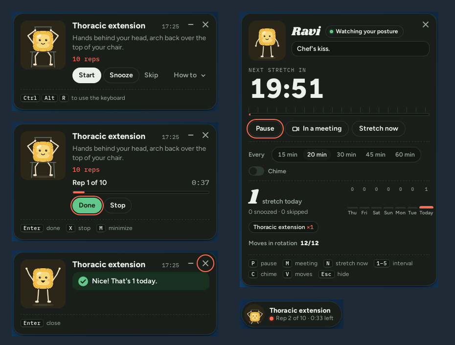

# Ravi the Ravioli

[](https://github.com/yahiaelsamman/ravi-posture/actions/workflows/build.yml)

A small posture coach for your desktop. Every 20 minutes a ravioli slides in at the top right of your
screen with a quick desk stretch: chin tucks, a doorway chest stretch, a lap around the flat. Start it and
Ravi times your reps; snooze it and he's back in five minutes, slightly offended. A daily tally and the
last seven days sit one shortcut away.



- **Never steals your typing.** The card appears without taking the keyboard. Ctrl+Alt+R (⌃⌥R on a Mac)
  hands it over, and pressing it again gives the keyboard back to the app you were in.
- **Keyboard all the way.** Enter starts, D finishes, S snoozes, X skips, M tucks it into a pill.
- **Knows when you're away.** Lock the screen or close the lid for 3+ minutes and the clock starts over.
- **In a meeting?** One switch holds any stretch until you're out.
- **24 moves** for neck, back, chest, shoulders, hands, hips, legs, eyes and breathing, drawn from office-ergonomics and
  physio desk routines. All of them work at a desk with no floor and no kit, so they fit an office, a library or home.
  Switch off the ones you don't want.
- **Ravi has a skeleton.** Fixed-length bones and two-bone IK keep his arms and legs from stretching, feet stay
  planted, hands open and close, and he switches sides with you halfway through a one-sided stretch.

## Install

Ready-made packages are on the [Releases](https://github.com/yahiaelsamman/ravi-posture/releases) page.

| | How | Details |
| --- | --- | --- |
| **macOS 13+** | `bash macos/build.sh` (builds and installs), or `Ravi-macos.zip` from Releases | [macos/](macos/README.md) |
| **Windows 10/11** | `Ravi-windows.zip` from Releases: unzip, double-click `install.cmd` | [windows/](windows/README.md) |
| **Linux** (Ubuntu/GNOME) | `bash linux/install.sh` | [linux/](linux/README.md) |

```bash
git clone https://github.com/yahiaelsamman/ravi-posture.git
cd ravi-posture
```

## How it's built

One card, three thin native shells. The card (the mascot, the stretch flow, the home card, the pill) is a
single HTML file every version loads into the platform's own web view. Each shell does only what the
operating system has to: a floating always-on-top window that doesn't take focus, the menu-bar or tray
icon, the global shortcut, start at login and noticing when the screen locks.

```
shared/     card.html, moves.json (the 24 moves and Ravi's lines), fonts, icons
windows/    C# on .NET Framework 4.8 + WebView2: tray icon, RegisterHotKey, Run key
linux/      Python + GTK 3 + WebKitGTK: top-bar indicator, GNOME custom shortcut, autostart entry
macos/      Swift + AppKit + WKWebView: menu-bar item, Carbon hot key, SMAppService login item
```

To change a move or one of Ravi's lines, edit `shared/moves.json` and reinstall.

### Building

- **macOS:** `macos/build.sh` compiles with `swiftc` (Xcode Command Line Tools).
- **Windows:** `cd windows && dotnet build -c Release` (works on Windows, Linux or macOS with the .NET SDK).
- **Linux:** nothing to build; `linux/install.sh` installs the Python app and its dependencies.

GitHub Actions builds and tests all three on their own operating systems for every push
([`.github/workflows/build.yml`](.github/workflows/build.yml)). Pushing a tag such as `v1.0.0` publishes the
packages as a release.

### Tests

- `macos/Tests` and `windows/tests/CoreTests` walk the timer, tally and keyboard logic through the same
  working day with a fake clock (60 and 51 checks).
- `windows/tests/card_test.py` drives `shared/card.html` in Chromium the way the Windows app does
  and checks every message the card sends back.

## Credits

Inspired by a reel of Anthropic's "Tony the Rigatoni" posture reminder; Ravi, his poses and the code are original.
Fonts: Shrikhand, Figtree and IBM Plex Mono under the SIL Open Font License (see `shared/fonts/OFL.txt`).
The moves are everyday mobility exercises, not medical advice; skip anything that hurts.

Code under the MIT License, see [LICENSE](LICENSE).
